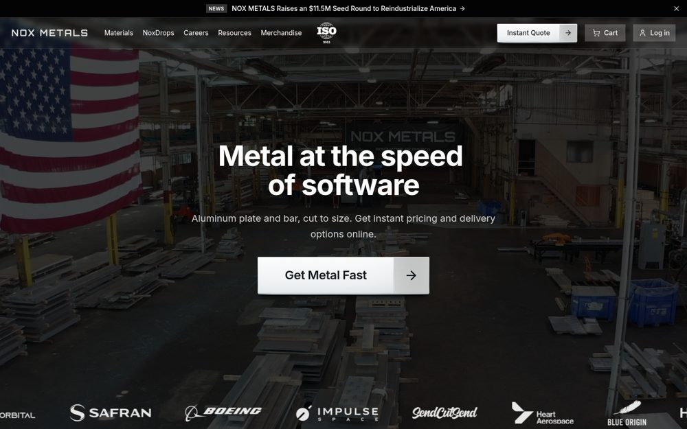
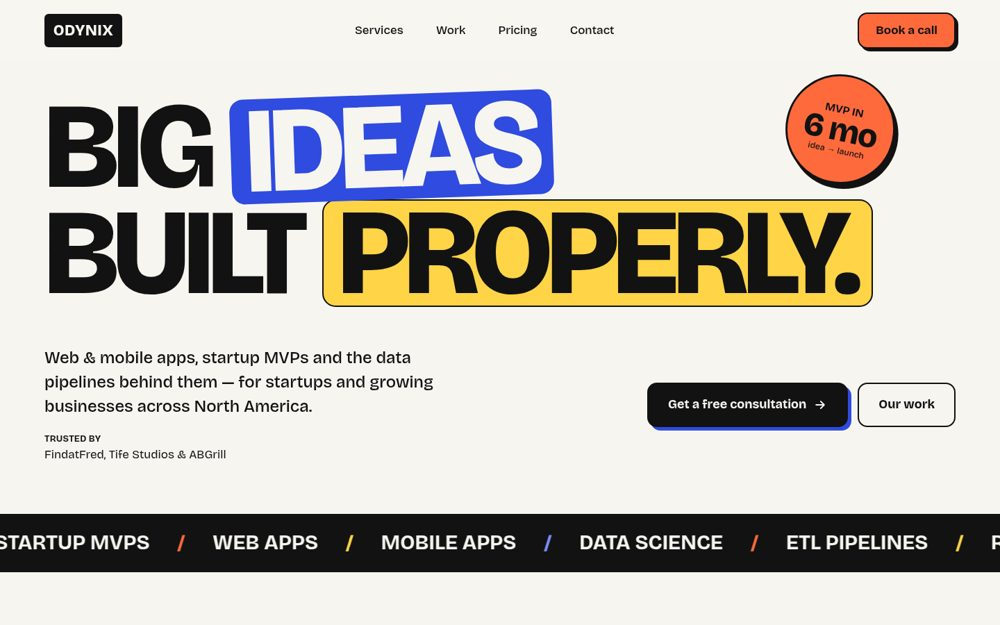
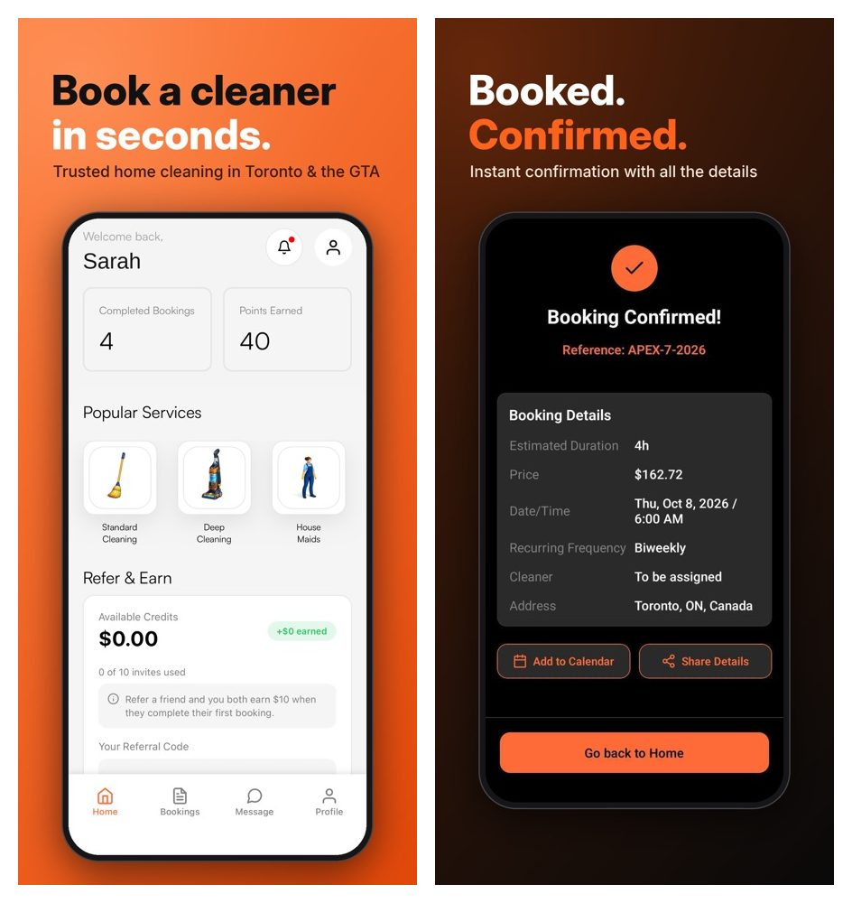
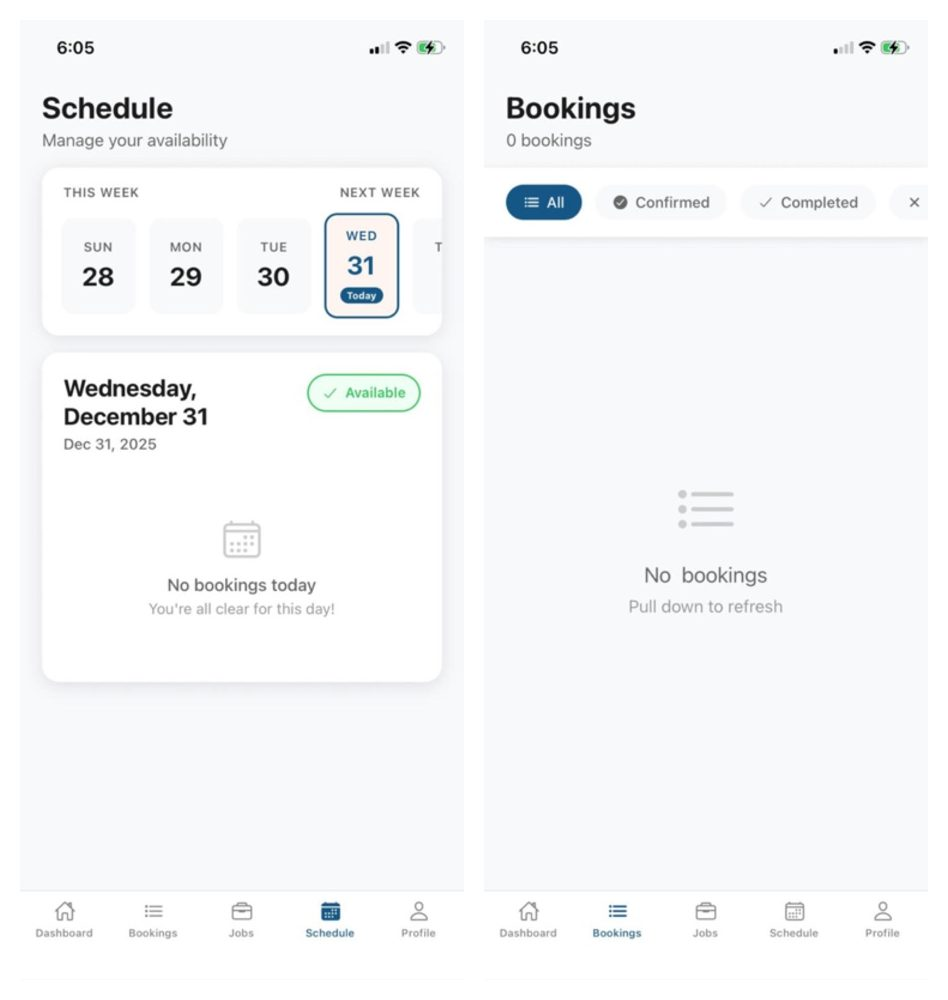

I'm Greg, a full-stack engineer in Windsor, Ontario. I'm the founding engineer at Nox Metals (YC S25), working in TypeScript, Next.js and Postgres. Before that I was tech lead at Apex Shine, where I built two React Native apps and the NestJS backend behind them, with Stripe payments and over-the-air releases. Earlier I built banking APIs at CWG and UBA.

### Things I've shipped

<table>
  <tr>
    <td width="50%" valign="top">
       
      <b><a href="https://noxmetals.co">Nox Metals</a></b> 
      Instant quoting for aluminum plate
    </td>
    <td width="50%" valign="top">
       
      <b><a href="https://www.odynix.tech">Odynix</a></b> 
      Web, mobile and data development for startups
    </td>
  </tr>
  <tr>
    <td width="50%" valign="top">
       
      <b><a href="https://apps.apple.com/ca/app/apexshine-cleaning-on-demand/id6746707857">ApexShine: Cleaning on Demand</a></b> 
      Customer app for booking home cleaning (iOS)
    </td>
    <td width="50%" valign="top">
       
      <b><a href="https://apps.apple.com/ca/app/apexshine-pro-for-cleaners/id6754331878">ApexShine Pro for Cleaners</a></b> 
      Companion app for cleaners to take and run jobs (iOS)
    </td>
  </tr>
</table>

### Other Projects

**InboxAgent — AI email-to-database agent**\
*TypeScript, NestJS, Claude API, Postgres, BullMQ*
- Built an AI agent that reads incoming emails, pulls out the key fields (orders, quotes, invoices) and writes them into Postgres as validated records, cutting manual data entry by 100%.
- Built an eval suite of labeled real-world emails that runs in CI on every change. Extraction accuracy rose and prompt or model changes can't ship if they make it worse.
- Tracked cost and speed per email, by model and by step, on a live dashboard. Prompt caching and sending each email to the right-sized model cut average cost by 23%.
- Added a human review step for low-confidence extractions, so uncertain records are never written silently.

**Cross-platform mobile app (App Store and Google Play)**\
*Expo, React Native, TypeScript, EAS, SQLite*
- Shipped a polished mobile app to the App Store and Google Play.
- Built offline-first sync on a local SQLite store, with background sync and conflict resolution. The app works fully without a connection and catches up cleanly once it's back online.
- Set up over-the-air updates through EAS with a release pipeline. Most fixes reach users in minutes, with no app store review.
- Added push notifications that trigger on user actions and schedules.

**pgsleuth — Postgres query performance analyzer**\
*TypeScript/Go, PostgreSQL, GitHub Actions*
- Built and published an open-source CLI and GitHub Action that flags slow Postgres queries, missing indexes and full-table scans before they reach production.
- Grew it from the work behind a 70x query speedup. It turns that manual diagnosis into automatic checks that comment on PRs with suggested fixes.

[LinkedIn](https://linkedin.com/in/gregoryjs) · gregory.odiase01@gmail.com
